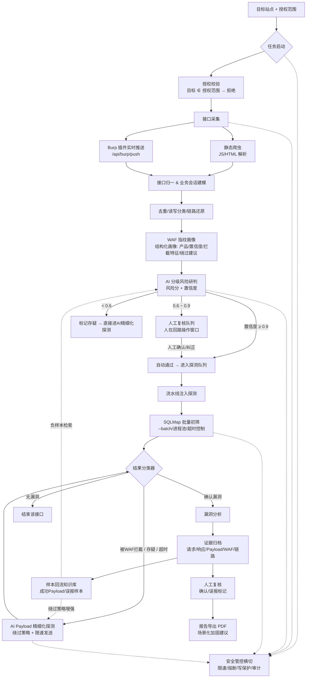

# mhszed-sql · 全链路 Web 安全测试系统 —— 架构设计文档

> 版本：v1.0（2026-10-13）
> **2026-10-22 更新：当前审计思路与完整工具流程见 `docs/06-审计思路与工具流程.md`。**
> 定位：授权范围内的 Web 安全测试平台，仅用于合法授权测试，内置授权校验、限速、熔断、写接口保护与全链路审计。

---

## 1. 总体架构（分层视图）

```
┌─────────────────────────────────────────────────────────────────────┐
│                    前端 UI（Vue3 + Element Plus，深色主题）             │
│  任务面板 │ 采集页 │ AI研判页 │ 扫描配置 │ 漏洞结果 │ 知识库 │ 审计日志   │
└──────────────────────────┬──────────────────────────────────────────┘
                           │ REST API + SSE（实时流式日志/进度）
┌──────────────────────────▼──────────────────────────────────────────┐
│                     后端服务（Python FastAPI）                        │
│                                                                     │
│  ┌─────────── API 路由层 ───────────┐   ┌──────── 中间件 ─────────┐  │
│  │ /api/task  /api/collect  /api/ai  │   │ 授权校验 │ 限速 │ 审计   │  │
│  │ /api/scan  /api/vuln    /api/kb   │   │ 熔断器   │ 写接口保护   │  │
│  │ /api/burp/push  /api/audit        │   └────────────────────────┘  │
│  └───────────────────────────────────┘                               │
│                                                                     │
│  ┌────────────────────── 业务服务层（Services）────────────────────┐  │
│  │ ① 任务管理   任务生命周期状态机、终止信号                         │  │
│  │ ② 接口采集   静态爬虫 + Burp 插件实时推送，双模式合并              │  │
│  │ ③ 归一建模   接口归一去重、读写分类、业务会话链路还原               │  │
│  │ ④ WAF画像    指纹特征库 + 打分，产出产品级画像（非二元判断）        │  │
│  │ ⑤ AI引擎     分级研判（人在回路）+ Payload构造 + 绕过策略生成       │  │
│  │ ⑥ 探测调度   流水线协同：SQLMap批量初筛 → AI精细化Payload试探      │  │
│  │ ⑦ 安全管控   速率熔断、写接口禁破坏性语句、授权范围校验             │  │
│  │ ⑧ 知识库     成功Payload/误报样本回流，WAF绕过知识库              │  │
│  │ ⑨ 证据归档   请求/响应/Payload/链路 完整证据链，PDF报告导出        │  │
│  └────────────────────────────────────────────────────────────────┘  │
│                                  │                                  │
│  ┌─────────────── 外部集成层 ──────▼───────────────────────────────┐ │
│  │ SQLMap（subprocess 进程调用，参数隔离，状态管理）                    │ │
│  │ AI（OpenAI 兼容接口：base_url/api_key/model 运行时配置）            │ │
│  │ Burp Suite（Java 16 原生扩展，HTTP 回调推送流量）                    │ │
│  └────────────────────────────────────────────────────────────────┘ │
└──────────────────────────┬──────────────────────────────────────────┘
                           │ SQLAlchemy ORM（方言隔离，可切换）
                 ┌─────────▼─────────┐
                 │  SQLite 数据库文件  │
                 │  data/scanner.db  │
                 └───────────────────┘
```

## 2. 模块划分与职责

| # | 模块 | 职责 | 关键设计点 |
|---|------|------|-----------|
| 1 | 任务管理 `task` | 任务 CRUD、状态机（等待→采集中→扫描中→人工复核→完成/终止）、终止信号传播 | 状态机集中管理，禁止跨状态跳变；终止通过 CancellationToken 式标志位层层下发 |
| 2 | 接口采集 `collector` | ① 静态爬虫：解析前端 JS/HTML 提取 API 路径与参数；② Burp 推送接收：`/api/burp/push` 接收插件流量 | 双模式采集结果统一进入原始接口池；Burp 推送带幂等去重键 + 失败重推队列 |
| 3 | 归一建模 `normalizer` | 接口归一（method+路径模板+参数结构 → 指纹去重）、读写分类（GET/HEAD→读，POST/PUT/DELETE/PATCH→写，结合语义修正）、业务会话链路还原 | 按 Referer 跳转链 / Token 派生关系 / 时间序聚类还原"登录→浏览→下单"式业务链，为写接口保护和误报判断提供上下文 |
| 4 | WAF 画像 `waf` | 发送无害探针（无 payload 特征请求）采集响应特征，与指纹库比对打分 | 输出结构化画像：`{有无WAF, 产品名, 置信度, 拦截行为特征(状态码/页面指纹/header), 建议绕过策略}`；指纹库覆盖 ModSecurity / 阿里云盾 / 腾讯云WAF / 安全狗 / D盾 / 宝塔 / 雷池 / Cloudflare / F5 等常见产品 |
| 5 | AI 引擎 `ai` | ① 接口风险研判：输出风险分 + 置信度 + 理由；② Payload 构造：针对被拦截/存疑接口自适应生成绕过 Payload；③ 绕过策略生成 | 分级人在回路：置信度 ≥0.9 自动通过；0.6~0.9 进人工复核队列；<0.6 判存疑转深测。内置安全约束：AI 输出必须为 JSON Schema 校验过的结构化数据，Payload 黑名单（DROP/DELETE/TRUNCATE/UPDATE 等破坏性语句直接拒绝），从不让 AI "自由发挥"发请求 |
| 6 | 探测调度 `scheduler` | 流水线编排：SQLMap 批量初筛（--batch 非交互、超时控制、进程池）→ 筛出「被WAF拦截 / 结果存疑」接口 → AI Payload 精细化试探（限速 HTTP 客户端逐条发） | 两引擎**流水线协同而非互斥**：SQLMap 结果分类器（确认漏洞/无漏洞/被拦截/存疑/超时）决定接口去向；AI 试探结果同样回流分类器 |
| 7 | 安全管控 `safety` | ① 授权校验：目标域名必须命中任务授权范围表（支持精确域名/通配符），否则拒绝启动；② 速率熔断：滑动窗口统计错误率与 WAF 拦截率，超阈值自动暂停并告警；③ 写接口保护：写接口注入探测只允许时间盲注/布尔盲注判据，禁止执行改变数据的语句；④ 审计：全操作落库 | 熔断器三态（关闭/打开/半开恢复）；写接口保护在 HTTP 客户端层强制拦截，不依赖调用方自觉 |
| 8 | 知识库 `kb` | WAF 绕过 Payload 库、误报样本库；人工增删改查；自动回流 | 回流闭环：确认漏洞 → Payload 入成功库；人工标记误报 → (接口特征+响应特征) 入误报库，AI 下次研判前先检索误报库做负样本匹配 |
| 9 | 证据归档 `evidence` | 漏洞证据链存储（完整请求包/响应包/Payload/WAF信息/业务链路/时间戳）；PDF 报告导出 | 证据只追加不修改；报告按任务聚合，含场景化加固建议（按漏洞类型+框架给出） |
| 10 | 审计日志 `audit` | 所有操作（登录、配置变更、任务启停、扫描动作、人工复核、导出）落库 | 独立表 + 不可篡改设计（链式哈希可选）；UI 独立页面可检索 |

## 3. 核心数据流



**流水线协同要点**（区别于互斥模式）：
- SQLMap 是**吞吐引擎**：大批量、标准技术、快；
- AI Payload 是**穿透引擎**：只接 SQLMap 搞不定的（被拦截/存疑），低并发、慢速、带绕过策略；
- 结果分类器是两引擎之间的**路由器**，接口可在两个引擎间最多往返 N 轮（默认 2，可配），防止死循环。

## 4. 关键难点设计对策

| 难点 | 对策 |
|------|------|
| **会话链路还原限制** | 三级还原策略：① Referer/来源链直接还原；② 无 Referer 时按 Token/Cookie 派生关系聚类；③ 仍无依据时按时间序 + 路径语义聚类，标记 `inferred=true`（推断链路，置信度降级）。推断链路只用于展示与误报辅助判断，**不作为写接口探测的放行依据** |
| **AI Payload 误报控制** | ① 误报样本库前置检索（负样本匹配）；② 每个 AI Payload 必须带"预期判据"（布尔差异/延时阈值/回显特征），响应必须同时满足判据才算命中；③ 单接口要求 ≥2 个不同向量的 Payload 一致命中才产出漏洞；④ 全部命中样本进入人工复核而非直接定级 |
| **SQLMap 进程状态管理** | ① 每个扫描子任务独立 subprocess + PID 登记；② 超时强杀（taskkill /tree）；③ 任务终止时进程组回收；④ 僵尸进程心跳检测（轮询 poll()）；⑤ 输出文件与数据库状态双写，崩溃后可对账 |
| **Burp 插件推送稳定性** | ① 插件侧本地有界队列，推送失败自动重试 + 丢弃计数；② 后端接收幂等（请求哈希去重）；③ 心跳接口监测连接状态，UI 展示 Burp 连接状态灯；④ 批量聚合推送降低请求频率 |

## 5. 目录结构

```
mhszed-sql/
├── backend/                    # 后端
│   ├── app/
│   │   ├── main.py             # FastAPI 入口
│   │   ├── core/               # 配置、数据库会话、安全、审计
│   │   ├── models/             # SQLAlchemy ORM 模型
│   │   ├── schemas/            # Pydantic 请求/响应模型
│   │   ├── api/                # 路由：task/collect/ai/scan/vuln/kb/burp/audit
│   │   ├── services/           # 业务服务层（10 大模块）
│   │   └── utils/              # 工具函数
│   ├── sqlmap_adapter/         # SQLMap 进程封装、输出解析器
│   ├── tests/                  # 测试
│   └── requirements.txt
├── frontend/                   # 前端
│   ├── src/
│   │   ├── views/              # 7 个页面组件
│   │   ├── api/                # axios 封装
│   │   ├── stores/             # Pinia
│   │   ├── router/
│   │   └── components/         # 公共组件（日志流、分页表格等）
│   └── package.json
├── burp-plugin/                # Burp Java 扩展（--release 16）
│   ├── src/main/java/...
│   ├── build.gradle
│   └── README.md
├── docs/                       # 文档（架构/库表/部署/演示案例）
├── data/                       # SQLite 数据库文件（运行时生成）
├── DEVELOPMENT-PROGRESS.md     # 开发进度台账（断点续传用）
└── README.md
```

## 6. API 概览（前后端约定）

| 分组 | 端点示例 | 说明 |
|------|---------|------|
| 任务 | `POST /api/task` `GET /api/task` `POST /api/task/{id}/stop` | 新建/列表/终止 |
| 采集 | `POST /api/collect/static` `GET /api/collect/endpoints?task_id=` | 静态爬虫启动、接口列表（分页） |
| Burp | `POST /api/burp/push` `GET /api/burp/heartbeat` | 流量推送（幂等）、心跳 |
| AI | `POST /api/ai/reassess` `GET /api/ai/review-queue` `POST /api/ai/review/{id}` | 重新研判、复核队列、人工复核提交 |
| 扫描 | `POST /api/scan/config` `GET /api/scan/progress`（SSE） | 扫描配置、实时进度流 |
| 漏洞 | `GET /api/vuln` `GET /api/vuln/{id}/evidence` `GET /api/vuln/report?task_id=&format=pdf` | 列表、证据链、报告导出 |
| 知识库 | `GET/POST/PUT/DELETE /api/kb/payloads` `GET /api/kb/false-positives` | 增删改查 |
| 审计 | `GET /api/audit/logs` | 检索 |
| 系统 | `GET /api/stream/logs`（SSE） | 全局实时日志 |

## 7. 端到端测试流程模块

内置一条可一键执行的完整链路（作为独立服务 `e2e` 提供，同时是「测试演示案例」的执行入口）：

```
前置授权校验 → 接口采集 → WAF指纹画像 → AI分级研判(人在回路)
→ SQLMap批量初筛 → 存疑/拦截接口交AI构造Payload探测
→ 漏洞证据归档 + 样本回流知识库 → 人工复核 → 报告导出
```

每个阶段产出落库并推送 SSE 进度；任一阶段触发熔断 → 全链路暂停并等待人工恢复；
写接口保护与审计在全程横切生效。
